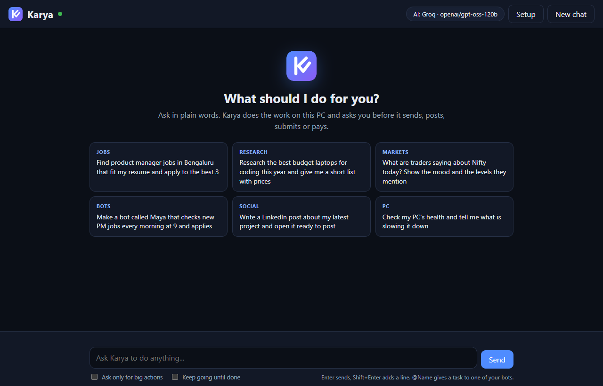
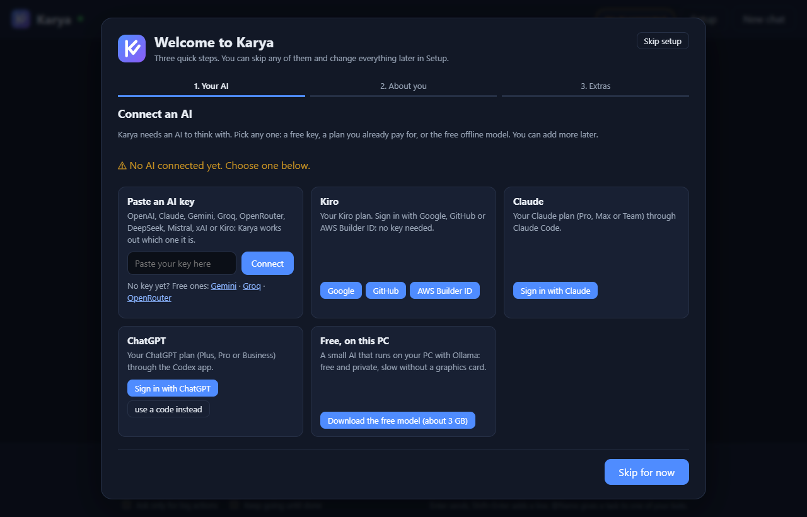
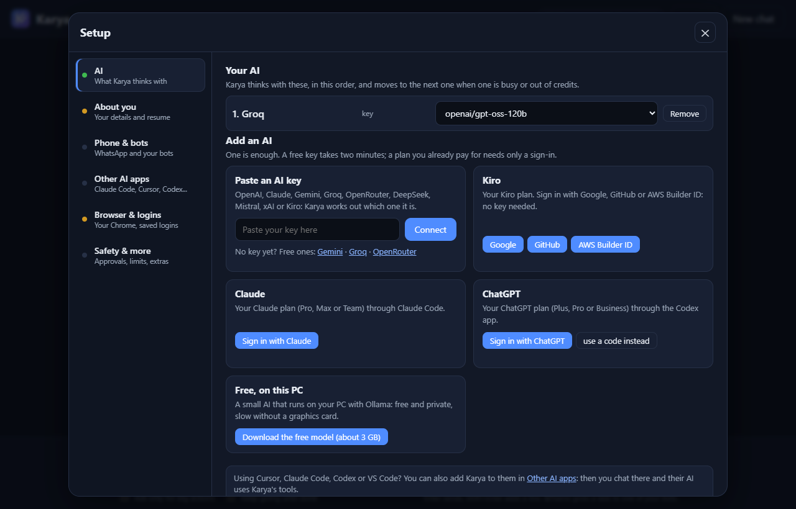
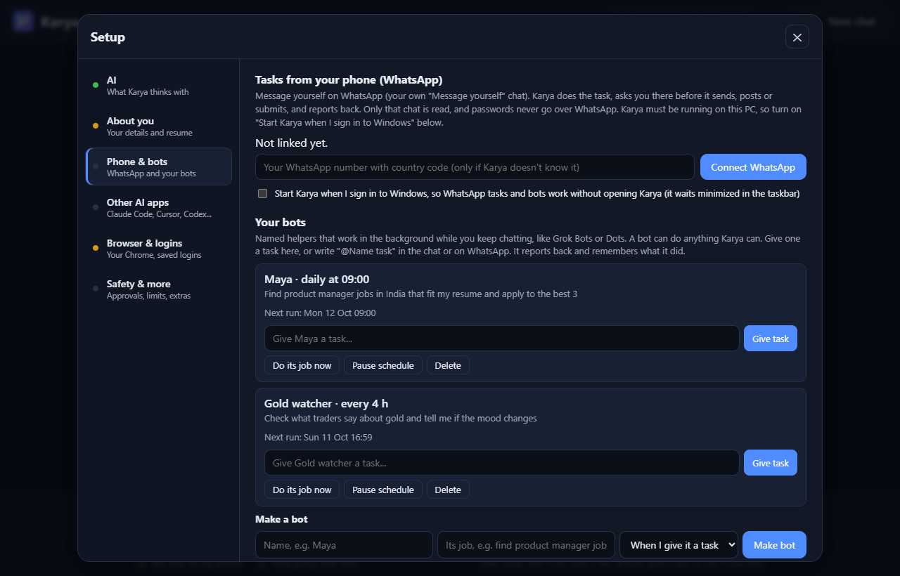
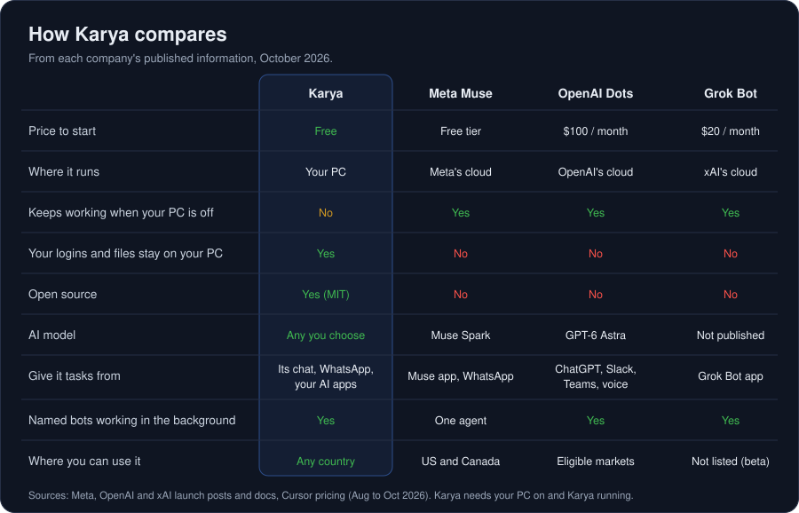
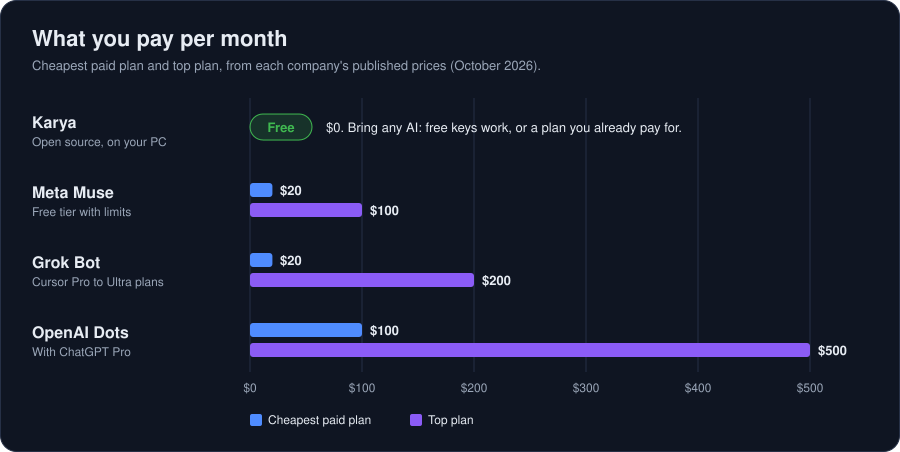
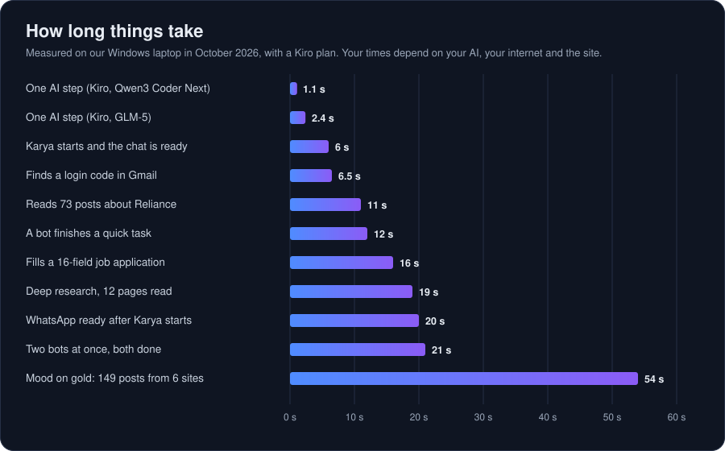

<p align="center"></p>

<h1 align="center">Karya</h1>

<p align="center">
Your own AI agent for Windows. Tell it what you need and it does the work: it finds and applies for jobs, researches, watches markets, sends email, posts on your socials and fixes your PC.<br>
Free and open source. It runs on your PC, with the AI you choose and your own logins.
</p>

<p align="center">
<a href="#install">Install</a> ·
<a href="#connect-an-ai">Connect an AI</a> ·
<a href="#use-karya-inside-your-ai-apps">Other AI apps</a> ·
<a href="#your-phone-and-your-bots">Phone and bots</a> ·
<a href="#compared-with-muse-dots-and-grok-bot">Compare</a> ·
<a href="#safety">Safety</a>
</p>



*Karya* (कार्य) means "work" in Hindi.

## What you can ask

Ask in plain words, in Karya's chat, on WhatsApp, or from another AI app.

| You ask | Karya |
|---|---|
| Find product manager jobs in Bengaluru that fit my resume and apply to the best 3 | searches company career sites, ranks the jobs against your resume and lets you pick. For each pick it tailors your resume, fills in the form and submits once you approve |
| What are traders saying about Nifty today? | reads StockTwits, Reddit, X, TradingView, forums, YouTube and the news, then reports the mood, the price levels people mention and real quotes with links |
| Research the best budget laptops for coding | searches, reads a dozen pages and gives you a short answer with the sources |
| Make a bot called Maya that checks new PM jobs every morning at 9 and applies | makes a bot that does it every day and reports to you on WhatsApp |
| Email these 5 startups about my design services | finds their public addresses and writes each one a personal email. You approve every send |
| Post this video on LinkedIn and X | uploads the video, writes the post and asks before it posts |
| My PC is slow | checks what's using memory, disk and CPU, and fixes it with your OK |
| Build me a portfolio website | builds it from your resume, shows a preview and can publish it on Vercel |

## Install

You need Windows 10 or 11, [Python 3.11 or newer](https://www.python.org/downloads/) (tick "Add Python to PATH" in the installer) and Google Chrome.

1. Download Karya. On this page click **Code > Download ZIP** and unzip it, or run `git clone https://github.com/Muraligopalakrishna/karya.git`.
2. Double-click `start.bat`. The first start installs what Karya needs, which takes a few minutes, then opens Karya in your browser.
3. Follow the welcome guide. It asks three things and you can skip any of them:
   - your AI (see the next section)
   - about you: your name, email and city, and your resume, which Karya reads once and tailors for every job
   - extras: tasks from WhatsApp, your own Chrome, and starting Karya with Windows



Everything stays on your PC. Your settings live in `.env` and your data in `data/`, and git leaves both out. There is no Karya server and no Karya account. Setup is the button at the top right, and **Setup > Safety & more** shows the welcome guide again.

## Connect an AI

Karya needs an AI to think with. One is enough. If you add more, Karya moves to the next one when one is busy or out of credits. Open **Setup > AI** and pick one:

| Choose | What you do | What it costs |
|---|---|---|
| Paste a key | Paste a key from OpenAI, Claude, Gemini, Groq, OpenRouter, DeepSeek, Mistral, xAI or Kiro. Karya works out which service it's from and checks it. | Free keys: [Gemini](https://aistudio.google.com/apikey), [Groq](https://console.groq.com/keys), [OpenRouter](https://openrouter.ai/keys) |
| Kiro | Click Google, GitHub or AWS Builder ID and sign in. Needs the [Kiro CLI](https://kiro.dev/downloads). | Your Kiro plan |
| Claude | Click **Sign in with Claude**. Needs [Claude Code](https://claude.com/claude-code). If Claude Code is already signed in on your PC, click **Use Claude**. | Your Claude plan |
| ChatGPT | Click **Sign in with ChatGPT**. Needs the Codex CLI: install [Node.js](https://nodejs.org), then run `npm install -g @openai/codex`. | Your ChatGPT plan |
| Free, on this PC | Install [Ollama](https://ollama.com/download), then click **Download the free model** (about 3 GB). | Free and private, but slow without a graphics card |

Then pick the model from the list your key or plan offers, and choose which AI goes first. Karya learns each key's limits, so small free plans get small requests and big paid plans run at full speed.

Karya runs Claude Code and Codex with their own tools switched off, so they only think and Karya does the work. Your plan's usage limits apply as usual.



## Use Karya inside your AI apps

There are two ways to use Karya with Cursor, Claude Code, Codex, Kiro, VS Code and similar apps.

1. As Karya's brain (the section above). You chat in Karya, and your Claude, ChatGPT or Kiro plan does the thinking.
2. Inside the app. You chat in Cursor, Claude Code, Codex, Kiro, VS Code, Claude Desktop, Gemini CLI, Windsurf or Qwen Code, and its AI uses Karya's tools: a real Chrome with your logins, email, job search, tailored resumes and applications.

For the second way, open **Setup > Other AI apps**. It lists the AI apps on your PC with an **Add Karya** button each. Karya adds itself to that app's settings, keeps your other servers, and saves the old file next to it as `.before-karya`. Restart the app, then ask it something like "use Karya to find PM jobs and apply".

Karya still runs every check when another app is in charge, and asks you before it sends, posts, submits or pays (inside the app when it supports that, otherwise in Karya's window, which opens by itself).

<details>
<summary>Adding Karya by hand</summary>

Apps with a config file take this (use your own Karya folder):

```json
{ "mcpServers": { "karya": { "command": "C:\\Karya\\.venv\\Scripts\\python.exe", "args": ["C:\\Karya\\karya_mcp.py"] } } }
```

For CLIs it's one command, for example `claude mcp add --scope user karya -- "C:\Karya\.venv\Scripts\python.exe" "C:\Karya\karya_mcp.py"`. Setup > Other AI apps shows the exact config and commands for Codex, Gemini CLI, Qwen Code, Kiro CLI and VS Code, with copy buttons.

- The app starts Karya by itself if it isn't running.
- Karya needs no AI of its own here: the app's model does the thinking, including writing tailored resumes. Karya checks every fact against your real resume and makes the PDF.
- 40 tools are shared by default (Cursor allows about 40 in total). Pick others with `KARYA_MCP_TOOLS`, for example `browser,email`, or `all`.
- Submits, posts and bids come back as `RESULT: SUBMITTED`, `NOT SUBMITTED` or `UNCONFIRMED`. `karya_activity` lists what really happened today.
- Some apps stop a tool call after a minute. Give them a longer timeout so there's time to approve (Codex: `tool_timeout_sec = 900`).
- Passwords never reach the other app's AI, and Setup can switch MCP access off.

</details>

## Your phone and your bots

### Tasks from WhatsApp

**Setup > Phone & bots > Connect WhatsApp** opens WhatsApp Web in its own window. Link it once from your phone (WhatsApp > Settings > Linked devices > Link a device). After that you give Karya tasks in your own "Message yourself" chat:

- Karya answers "On it", does the task and sends you the result there.
- Before it sends, posts or submits, it asks you in that chat. Reply YES or NO, or with the numbers of the jobs to apply to.
- STATUS, STOP, BOTS and HELP work too. `@Maya find 3 PM jobs` gives the task to your bot Maya, and `STOP Maya` stops her.

Karya reads only that one chat, and passwords never go over WhatsApp. If nobody answers an approval within 30 minutes, Karya doesn't do it.

Karya has to be running on your PC to read WhatsApp. Turn on **Start Karya when I sign in to Windows** (in the same tab, or tell Karya "start with Windows") and it starts by itself, minimized, every time you sign in. If you send a message while Karya is off, it does the task when it starts, as long as the message is less than 6 hours old.

### Bots

Bots are named helpers, like Grok Bots or OpenAI's Dots, that work in the background while you keep chatting. A bot can do anything Karya can. Make one in Setup or just ask ("make a bot called Maya that finds PM jobs in India and applies"), then give it tasks with `@Maya ...` in the chat or on WhatsApp, or put it on a schedule ("every morning at 9", "every 4 hours").

Each bot keeps its own history and notes, so it knows what it already covered. Two bots work at the same time. They take turns with you on the browser, and your own chat always goes first. Setup can keep the PC from sleeping so scheduled bots run on time.



## Compared with Muse, Dots and Grok Bot





Meta Muse, OpenAI Dots and Grok Bot run on the companies' cloud computers, so they keep working when your PC is off. Karya runs on your PC instead. It costs nothing, works in any country, lets you choose the AI, and keeps your logins and files on your machine, but your PC has to be on.

## How fast it is



## Everything Karya can do

- Jobs straight from the companies, in any country. `find_jobs` searches Workday (Salesforce, Adobe, Nvidia, Cisco, Accenture, PwC, Walmart, Citi, Barclays and about 50 more), the Greenhouse, Lever, Ashby and SmartRecruiters boards of about 170 companies, Amazon, Microsoft, Google, Netflix and Atlassian, YC startups, Hacker News "Who is hiring", Indian boards (Instahyre, Cutshort, foundit), The Muse, Arbeitnow and remote boards. A web search finds more company job pages for your role and place. LinkedIn is a fallback when few jobs turn up, or when you ask for it.
- Recently funded startups. `find_funded_companies` reads funding news from any country and Y Combinator's latest batches, ranks the companies for you and lists their open roles.
- Applying. Karya reads the posting and the form, builds a resume tailored to that job (PDF), fills in everything it already knows in one step and asks you only what it can't know (notice period, salary, job dates). It never adds a skill you haven't confirmed, and it submits after you approve.
- It remembers what you applied to. New searches leave out jobs you already applied to and companies you applied to in the last 60 days, and Karya never submits the same job twice.
- Login codes. When a site sends a one-time code, Karya finds it in that site's newest email and types it in. A code that arrives by text message is asked for in the chat or on WhatsApp.
- Pop-ups. Nags like "Are you still looking for a job?", "Turn on notifications" and cookie banners are closed by themselves; dialogs that are part of your task stay open.
- Research. Web and news search, `deep_research` (a dozen pages read in one step) and `crawl_site` for a whole website, including sites you're logged into such as LinkedIn and X (it only reads there).
- Markets. Prices, history and news for NSE, BSE, US stocks and more, and `market_sentiment` for what traders say about any stock, coin, forex pair or index. It reports opinions, not advice.
- Email and outreach. `find_contacts` lists the public emails and social links of a website, and Karya writes personal emails that you approve one by one.
- Social posts on LinkedIn, X, Reddit, Instagram and more. With a video or photo it attaches the file first and posts only with it.
- Accounts. Karya can sign up on job portals for you with strong generated passwords, kept encrypted on your PC.
- PC help. Diagnose and fix problems, manage files, run commands (it asks first).
- Websites. Build, preview and publish to Vercel.

## Use your own Chrome

Karya browses in its own Chrome window by default. To let it work in your everyday Chrome, with the logins you already have, add the Karya Browser Link extension once:

1. Open `chrome://extensions` in Chrome and turn on **Developer mode** (top right).
2. Click **Load unpacked** and choose the `karya\extension` folder inside your Karya folder. **Setup > Browser & logins** shows the exact path with a copy button.

Whenever Karya runs, the extension connects by itself. Karya works only in its own tabs, in a purple "Karya" tab group, and can't see your other tabs. On game boards and maps Chrome may show a "started debugging this browser" bar for a few seconds while Karya clicks; that's the extension sending real mouse clicks.

## Safety

- Karya asks before it sends an email, posts, submits an application, pays, deletes or publishes. Commands and file changes ask too, unless you choose "Ask only for big actions".
- Full access (autopilot) is off by default. When you turn it on in Setup, Karya stops asking but every check still runs, and payments and account deletion still ask unless you turn that off too.
- Before a Submit, Karya checks for empty required fields. Afterwards it reads the page and says SUBMITTED only when the site confirms it.
- Form questions are answered from your resume and your own earlier answers. Anything else, Karya asks; it never guesses.
- CAPTCHAs are left for you to solve.
- Passwords are encrypted with Windows (DPAPI), typed only into the site they belong to, and never sent to the AI. Karya hides keys, tokens and passwords from anything the AI, the chat or the logs see.
- Web pages and emails are treated as data, never as instructions.
- The chat listens only on `127.0.0.1`, behind a private link. Every action is logged in `data/logs/actions.jsonl`.
- Daily limits (40 emails, 10 posts, 30 applications by default, changeable in Setup) keep your accounts from looking like spam. Sites like LinkedIn and X limit automated activity, so don't mass-apply or mass-post.

## Development

```
.venv\Scripts\python.exe -m pytest tests -q
```

`KARYA_SKIP_LIVE=1` skips the tests that need the internet, and `KARYA_RUN_OLLAMA=1` adds the slow offline-model test.

| Path | What's there |
|---|---|
| `karya/agent.py` | the agent loop |
| `karya/llm.py` | the AI client (keys, Kiro, Claude Code, Codex, Ollama) |
| `karya/tools/` | all tools |
| `karya/scheduler.py`, `karya/phone.py` | bots and WhatsApp |
| `karya/static/` | the chat page and Setup |
| `docs/` | logo, charts and screenshots |

To add a tool, write a function with the `@tool(...)` decorator and give it a risk level. The agent picks it up by itself.

## License

MIT, see [LICENSE](LICENSE).
